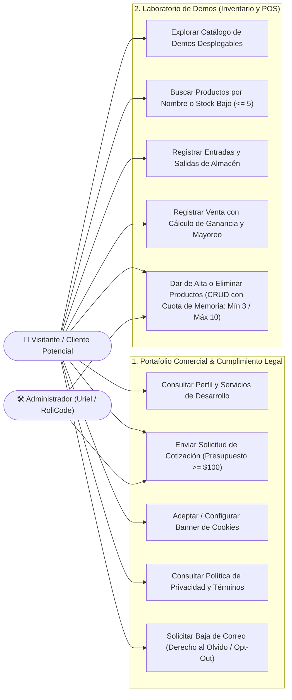
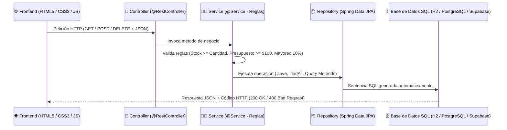
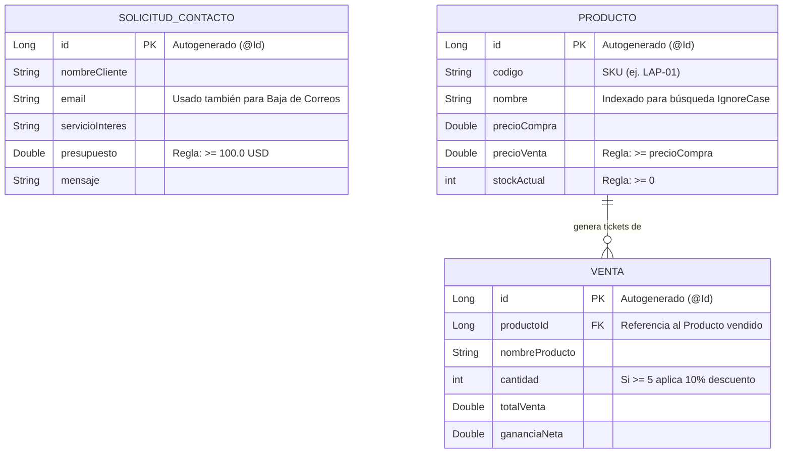

# 📐 Documentación de Arquitectura, Alcance y Cumplimiento Legal — Plataforma RoliCode

> [!IMPORTANT]
> Este documento constituye el expediente técnico y legal para revisiones de arquitectura, auditorías de código y cumplimiento normativo de protección de datos (**LFPDPPP / GDPR**) del proyecto **RoliCode Full-Stack Platform**.

---

## 1. Alcance del Proyecto (Project Scope)

### 1.1 Objetivo General
Desarrollar una plataforma web **Full-Stack** bajo la marca **RoliCode** que cumpla una doble función comercial y técnica:
1. **Portafolio Comercial y Captación de Clientes (Landing Page):** Presentación de servicios de desarrollo de software y recepción de solicitudes de cotización almacenadas en base de datos relacional SQL.
2. **Laboratorio Interactivo de Demos (Live Sandbox):** Entorno donde los clientes potenciales pueden probar en tiempo real sistemas empresariales funcionales (iniciando con el **Sistema de Inventario, Entradas, Salidas y Punto de Venta POS**).

### 1.2 Dentro del Alcance (In-Scope) vs. Fuera del Alcance (Out-of-Scope Actual)

| Módulo | ✅ Dentro del Alcance (Versión 1.0) | ⏳ Fase Futura (Versión 2.0) |
| :--- | :--- | :--- |
| **Portafolio & Marca** | Catálogo dinámico de servicios, perfil profesional e identidad visual animada **RoliCode**. | Blog técnico y sistema multi-idioma (ES/EN). |
| **Gestión de Clientes** | Formulario de cotización con validación de presupuesto mínimo (\$100 USD) y **Baja de Correos (Opt-Out)**. | Envío automático de correos transaccionales vía SMTP. |
| **Demo #1: POS Inventario** | CRUD completo de productos, entradas, salidas con validación de stock, cálculo de ganancias, descuento por mayoreo ($\ge 5$ uds) y filtros SQL. | Facturación PDF y lector de código de barras por cámara. |
| **Legal y Privacidad** | Banner de Cookies, Aviso de Privacidad, Términos y Condiciones, Baja de Correos y Auditoría de Licencias. | Panel de administración con autenticación JWT / Spring Security. |

---

## 2. Diagrama de Casos de Uso (Use Case Diagram)

En Ingeniería de Software, un **Diagrama de Casos de Uso** responde a dos preguntas: **¿Quién interactúa con el sistema (*Actores*)?** y **¿Qué acciones puede realizar cada uno (*Casos de Uso*)?**

---

## 3. Arquitectura en 4 Capas y Modelo de Base de Datos (ERD)

### 3.1 Flujo de Arquitectura en Capas (Spring Boot 4 + Java 21)

### 3.2 Diagrama Entidad-Relación (Tablas SQL)

---

## 4. Catálogo de Endpoints REST (Documentación de API)

| Método HTTP | Ruta (Endpoint) | Controlador | Descripción y Reglas de Negocio |
| :--- | :--- | :--- | :--- |
| `GET` | `/api/portafolio/perfil` | [PortafolioController.java](file:///home/urielrg/.gemini/antigravity/scratch/portafolio-web/src/main/java/com/portafolio/web/controller/PortafolioController.java) | Devuelve marca `RoliCode`, nombre, rol y estado. |
| `GET` | `/api/portafolio/servicios` | [PortafolioController.java](file:///home/urielrg/.gemini/antigravity/scratch/portafolio-web/src/main/java/com/portafolio/web/controller/PortafolioController.java) | Lista los servicios ofrecidos por RoliCode. |
| `GET` | `/api/portafolio/demos` | [PortafolioController.java](file:///home/urielrg/.gemini/antigravity/scratch/portafolio-web/src/main/java/com/portafolio/web/controller/PortafolioController.java) | Lista los proyectos del Laboratorio de Demos. |
| `POST` | `/api/portafolio/contacto` | [PortafolioController.java](file:///home/urielrg/.gemini/antigravity/scratch/portafolio-web/src/main/java/com/portafolio/web/controller/PortafolioController.java) | Guarda cotización si `presupuesto >= 100`. |
| `DELETE` | `/api/portafolio/contacto/baja` | [PortafolioController.java](file:///home/urielrg/.gemini/antigravity/scratch/portafolio-web/src/main/java/com/portafolio/web/controller/PortafolioController.java) | **Cumplimiento Legal:** Elimina los registros asociados a un `email` (Baja de correo). |
| `GET` | `/api/inventario/productos` | [InventarioController.java](file:///home/urielrg/.gemini/antigravity/scratch/portafolio-web/src/main/java/com/portafolio/web/controller/InventarioController.java) | Lista todos los productos del inventario. |
| `POST` | `/api/inventario/productos` | [InventarioController.java](file:///home/urielrg/.gemini/antigravity/scratch/portafolio-web/src/main/java/com/portafolio/web/controller/InventarioController.java) | Crea producto validando `precioVenta >= precioCompra`. |
| `DELETE` | `/api/inventario/productos` | [InventarioController.java](file:///home/urielrg/.gemini/antigravity/scratch/portafolio-web/src/main/java/com/portafolio/web/controller/InventarioController.java) | Elimina un producto por su `idProducto`. |
| `POST` | `/api/inventario/entrada` | [InventarioController.java](file:///home/urielrg/.gemini/antigravity/scratch/portafolio-web/src/main/java/com/portafolio/web/controller/InventarioController.java) | Suma unidades al `stockActual`. |
| `POST` | `/api/inventario/salida` | [InventarioController.java](file:///home/urielrg/.gemini/antigravity/scratch/portafolio-web/src/main/java/com/portafolio/web/controller/InventarioController.java) | Resta unidades validando `stockActual >= cantidad`. |
| `POST` | `/api/inventario/venta` | [InventarioController.java](file:///home/urielrg/.gemini/antigravity/scratch/portafolio-web/src/main/java/com/portafolio/web/controller/InventarioController.java) | Descuenta stock, aplica 10% mayoreo si `cantidad >= 5` y guarda ganancia. |
| `GET` | `/api/inventario/buscar` | [InventarioController.java](file:///home/urielrg/.gemini/antigravity/scratch/portafolio-web/src/main/java/com/portafolio/web/controller/InventarioController.java) | Busca por nombre (`ContainingIgnoreCase`). |
| `GET` | `/api/inventario/stock-bajo` | [InventarioController.java](file:///home/urielrg/.gemini/antigravity/scratch/portafolio-web/src/main/java/com/portafolio/web/controller/InventarioController.java) | Filtra productos con `stockActual <= limite`. |

---

## 5. Auditoría de Licencias de Activos (Fuentes, Imágenes, Logos y Librerías)

> [!TIP]
> **Resultado de la Auditoría de Propiedad Intelectual:** **100% Libre de Regalías y Apto para Uso Comercial.** No se utilizan fuentes comerciales restringidas ni imágenes con derechos de autor de terceros.

| Tipo de Activo | Recurso Utilizado en el Proyecto | Licencia / Estado Legal | Uso Comercial Permitido |
| :--- | :--- | :--- | :--- |
| **Logotipo RoliCode** | Código vectorial SVG propio (`<svg class="rolicode-espiral">`) + diseño original de Uriel (`RoliCode`). | **Propiedad Intelectual 100% de Uriel (RoliCode)**. | ✅ Sí (Autoría propia) |
| **Escena Lunar y Olas** | Gradientes CSS3 y cálculos matemáticos `Math.sin()` implementados desde cero en [styles.css](file:///home/urielrg/.gemini/antigravity/scratch/portafolio-web/src/main/resources/static/styles.css) y [app.js](file:///home/urielrg/.gemini/antigravity/scratch/portafolio-web/src/main/resources/static/app.js). | **Código propio (Dominio del proyecto)**. No copia imágenes externas. | ✅ Sí |
| **Tipografías (Fuentes)** | `system-ui, -apple-system, 'Segoe UI', sans-serif` (Native OS Font Stack). | **Fuentes nativas del sistema operativo del visitante** (No redistribuye archivos `.ttf`/`.woff` con copyright). | ✅ Sí (Estándar W3C) |
| **Iconografía** | Emojis estándar Unicode (`🚀`, `📦`, `🛒`, `🗑️`, `⚠️`). | **Estándar Abierto Unicode Consortium**. | ✅ Sí |
| **Motor Backend** | OpenJDK 21, Spring Boot 4.1.2, Hibernate ORM, H2 Database, PostgreSQL JDBC Driver. | **Apache License 2.0 / GPLv2+CE / PostgreSQL License / EPL 2.0** (Open Source empresarial). | ✅ Sí |

---

## 6. Especificación de Cumplimiento Legal (Privacidad, Términos, Cookies y Baja)

1. **Banner de Cookies Técnicos:** Informa al usuario del uso de almacenamiento local estrictamente necesario para recordar su preferencia de consentimiento (`localStorage.getItem('rolicode_cookies_accepted')`).
2. **Política de Privacidad y Protección de Datos (Derechos ARCO / GDPR):** Detalla qué datos se recolectan en el formulario de cotización (`nombre`, `email`, `servicioInteres`, `presupuesto`, `mensaje`), con qué finalidad (únicamente responder a la cotización solicitada) y que no se comparten con terceros.
3. **Términos y Condiciones de Uso:** Aclara que los precios mostrados o simulados en el *Laboratorio de Demos* son de carácter demostrativo y toda contratación formal se rige por propuesta firmada con **RoliCode**.
4. **Mecanismo Automatizado de Baja de Correos (Opt-Out / Derecho de Cancelación):** Cualquier titular puede ingresar su correo electrónico en la sección de baja para eliminar de forma inmediata y definitiva sus solicitudes de la base de datos SQL.
